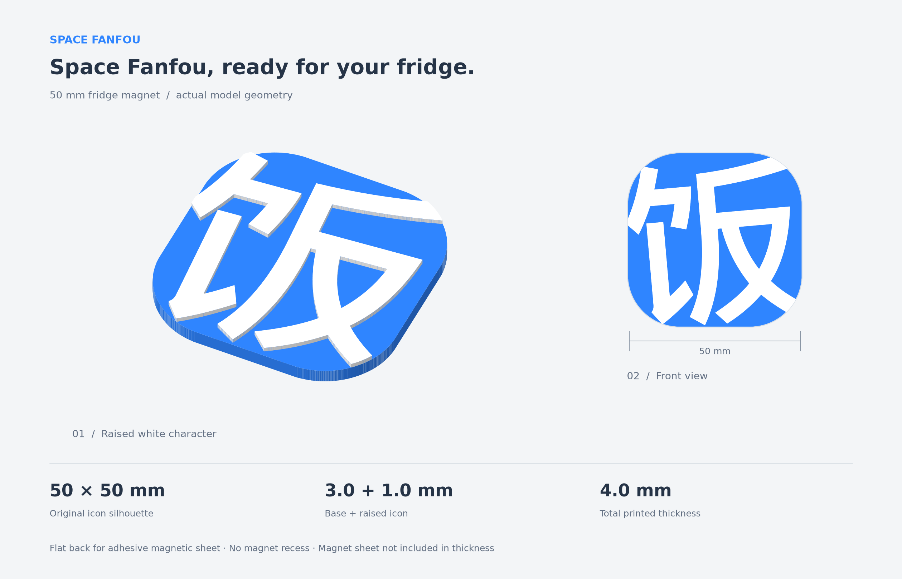

# Space Fanfou fridge magnet

A two-color relief magnet traced from the committed
[`icon-640.png`](../../public/icons/icon-640.png). The repository's
`assets/images/fanfou-logo.svg` is the Fanfou website wordmark, not this extension
icon. `space-fanfou.svg` is a new polygonal vector trace, not an original design
source. The original blue gradient is flattened to `#2F85FF`; the white character
and the icon's outer silhouette retain their source proportions.



| Parameter | Value |
| --- | --- |
| Footprint | 50 × 50 mm, traced icon silhouette |
| Blue base | 3 mm |
| White relief | 1 mm |
| Total printed thickness | 4 mm, excluding magnetic backing |
| Back | Flat, no magnet recess |

## Print files

- `space-fanfou-magnet-50mm.3mf`: configured Bambu project, blue base on filament 1,
  white character on filament 2. Open as a project to load the colors. It uses the
  same exporter and profile as the Xiaofan magnet: A1 mini, 0.4 mm nozzle,
  Bambu PLA Basic, `0.20mm Standard @BBL A1M`. Select the actual printer and
  loaded filament slots before slicing. No G-code is included.
- `space-fanfou-magnet-50mm.stl`: fused solid for other slicers; import in
  **millimetres**. STL does not contain colors or units.
- `part-base.stl`, `part-logo.stl`: aligned material parts. Import together as
  parts of one object; preserve the white part's Z = 3 mm position.
- `space-fanfou.svg`: reusable flattened vector, 50 mm viewBox and physical size.
- `validation.json`: measured dimensions, source mask agreement and mesh checks.

Print flat back down, white relief facing up, without supports. With one
extruder, change blue to white at Z = 3 mm; the 0.20 mm layer height aligns with
that boundary. Attach an adhesive flexible magnetic sheet to the back after
printing; a centered 40 × 40 mm sheet fits inside the silhouette. Magnetic
backing and adhesive add to the printed thickness. Holding strength has not
been measured.

## Regeneration

From the repository root, use Python 3.12+ in a virtual environment:

```sh
python -m pip install -r Artifacts/SpaceFanfouMagnet/requirements.txt
npm install --prefix Artifacts/SpaceFanfouMagnet
python Artifacts/SpaceFanfouMagnet/generate.py
```

Alternatively, set `SPACE_FANFOU_3MF_DEPENDENCIES` to an existing absolute
`package.json` path with the pinned Node dependencies installed. The generator
uses only the committed PNG; no source download or neighboring repository is
needed. `mesh_utils.py` and the exporter adapt the geometry, preview and
validation helpers from `xiaofan-ios/Artifacts/XiaofanMagnet` and
`FanfouCharacterMagnet`.

The trace uses alpha half-coverage for the silhouette and estimates the blue
gradient per row to isolate white coverage. Polygon simplification tolerance is
0.008 mm; the base is snapped to a 0.001 mm grid. White strokes that meet the
perimeter are clipped 0.01 mm inside it to prevent coincident side walls when
the meshes are fused. This adjustment is included in the source-mask check.

Checks reopen the fused STL and 3MF: one closed fused body, consistent winding,
two faces per edge, two closed material parts, dimensions, volume, color and
extruder assignments, layer height and independent 3MF scene import. The preview
shows the actual geometry without exaggerated thickness. Bambu Studio application
loading, slicing and a physical print have not been verified for this model.
