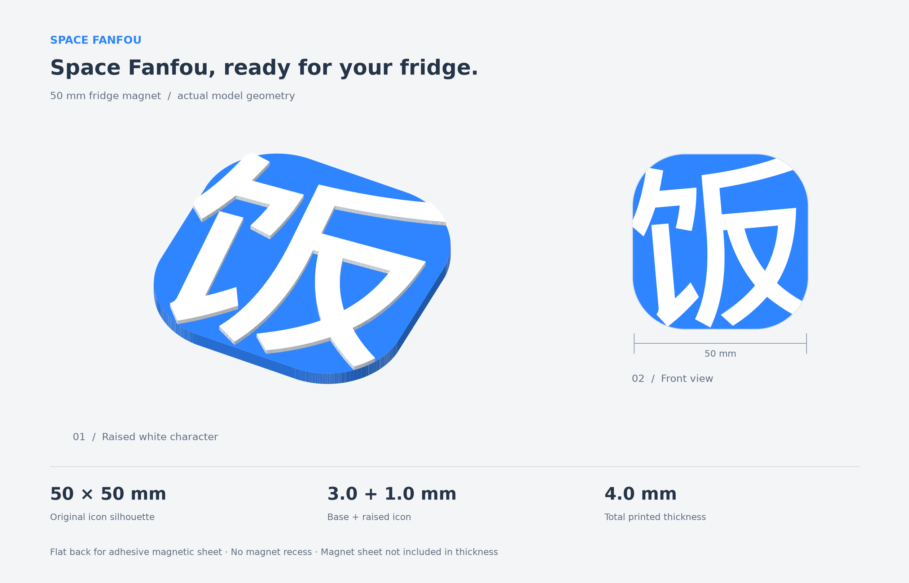

# 太空饭否冰箱贴

这款双色浮雕冰箱贴根据仓库中的
[`icon-640.png`](../../public/icons/icon-640.png) 描摹生成。仓库中的
`assets/images/fanfou-logo.svg` 是饭否网站的文字标志，并非此扩展的图标。
`space-fanfou.svg` 是重新描摹得到的多边形矢量图，并非原始设计源文件。
原图的蓝色渐变统一为纯色 `#2F85FF`，白色角色和图标外轮廓保留原图比例。



| 参数         | 数值                         |
| ------------ | ---------------------------- |
| 平面尺寸     | 50 × 50 mm，按图标外轮廓描摹 |
| 蓝色底座厚度 | 3 mm                         |
| 白色浮雕高度 | 1 mm                         |
| 打印总厚度   | 4 mm，不含背面的磁片         |
| 背面         | 平整，无磁铁凹槽             |

## 打印文件

- `space-fanfou-magnet-50mm.3mf`：已配置的拓竹工程，蓝色底座使用耗材 1，
  白色角色使用耗材 2。请以工程方式打开，以加载颜色配置。导出器和打印配置与小饭冰箱贴相同：
  A1 mini、0.4 mm 喷嘴、Bambu PLA Basic、`0.20mm Standard @BBL A1M`。
  切片前请选择实际使用的打印机和已装载的耗材槽位。文件不包含 G-code。
- `space-fanfou-magnet-50mm.stl`：供其他切片软件使用的合并实体，请以**毫米**为单位导入。
  STL 不包含颜色或单位信息。
- `part-base.stl`、`part-logo.stl`：已对齐的分色部件。请一起导入为同一对象的多个部件，
  并保留白色部件 Z = 3 mm 的位置。
- `space-fanfou.svg`：可复用的纯色矢量图，viewBox 对应 50 mm，实际尺寸也为 50 mm。
- `validation.json`：尺寸测量、与源图蒙版的一致性检查及网格检查结果。

打印时将平整背面朝下、白色浮雕朝上，无需支撑。使用单挤出机时，在 Z = 3 mm 处
将蓝色耗材换成白色；0.20 mm 的层高恰好与这一分界对齐。打印完成后，在背面贴上
自带背胶的柔性磁片；居中放置的 40 × 40 mm 磁片可完全容纳在外轮廓内。
磁片和背胶会增加成品总厚度。吸附力尚未测量。

## 直接购买

[](https://xhslink.com/m/894w257QBwb)

<a href="https://xhslink.com/m/894w257QBwb"></a>

## 重新生成

在仓库根目录下，使用 Python 3.12 或更高版本的虚拟环境执行：

```sh
python -m pip install -r Artifacts/SpaceFanfouMagnet/requirements.txt
npm install --prefix Artifacts/SpaceFanfouMagnet
python Artifacts/SpaceFanfouMagnet/generate.py
```

也可以将 `SPACE_FANFOU_3MF_DEPENDENCIES` 设置为现有 `package.json` 文件的绝对路径，
前提是该文件对应的固定版本 Node 依赖已安装。生成器只使用仓库中的 PNG，
无需下载源文件，也不依赖相邻仓库。`mesh_utils.py` 和导出器中的几何处理、预览及校验
辅助逻辑改编自 `xiaofan-ios/Artifacts/XiaofanMagnet` 和 `FanfouCharacterMagnet`。

描摹时，以 alpha 覆盖率 50% 为阈值提取外轮廓，并逐行估算蓝色渐变，以分离出白色区域。
多边形简化容差为 0.008 mm，底座顶点对齐到 0.001 mm 网格。
与外轮廓相接的白色笔画向内裁切 0.01 mm，避免合并网格时出现重合侧壁。
与源图蒙版的一致性检查已考虑这一调整。

校验时会重新打开合并后的 STL 和 3MF，检查：合并实体是否为单个封闭体、面片绕序是否一致、
每条边是否恰好连接两个面、两个分色部件是否各自封闭，以及尺寸、体积、颜色与挤出机分配、
层高和使用独立工具导入 3MF 场景的结果。预览展示实际几何形状，未夸大厚度。
此模型尚未验证在 Bambu Studio 中的加载、切片及实物打印效果。
